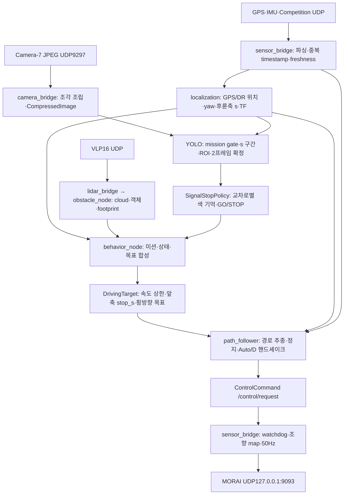

# 2026foscar-competition ROS1 port

원본 `../2026foscar-competition`을 비교 기준으로 보존한 독립 catkin 워크스페이스다. SCMC나 다른 RMT 구현을 가져오지 않았다. ROS1 이식 기준 브랜치는 `feat/ros1-port`, 기준 커밋은 `a1ea82efbf8d5f165201b7f51bf8a141439fb8c7`이다. 2026-10-13 일일 마감 업로드 대상은 당시 `origin/feat/ros1-port`였다. 현재 정리 브랜치는 `refactor/identifiers-docs`이며 push/main 병합은 별도 지시가 필요하다.

Windows 비교에 이어 실제 Ubuntu MORAI PC에서 Docker Noetic 빌드·ROS 메시지/TF·GPU 추론과 주행 일부를 확인했다. 전체 미션 및 ROS2/ROS1 실제 전송·주행 동등성이 입증된 상태는 아니다. 아래 실제 PC 인계 기록을 먼저 읽고, 뒤의 Windows 검증 표는 당시 이력으로 구분한다.

변경 경로는 [파일 안내](docs/CHANGES.md), 검증 수치와 범위는 [검증 결과](docs/verification.md)에 정리했다.

개인 Codex 작업 규칙은 [AGENTS.md](../AGENTS.md), 현재 우선순위·완료 기준·세션 인계는 [DEVELOPMENT_WORKFLOW](docs/DEVELOPMENT_WORKFLOW.md), 전체 Markdown 분류는 [MARKDOWN_INDEX](docs/MARKDOWN_INDEX.md)에 있다. 과거 팀 문서의 미완료 항목은 현재 backlog로 자동 승계하지 않는다. 이번 이름 정리 결과는 [변경 기록](docs/IDENTIFIERS_DOCS_2026-10-13.md)에 따로 남긴다.

Ubuntu MORAI PC의 Python 3.10/GPU Docker 재현 구성은 [Docker 실행 안내](docker/README.md),
Linux에서 실제 수행한 검사와 원본 센서 조건 차이는 [Docker 검증 기록](docs/NOETIC_DOCKER_VALIDATION.md)에 있다.
아래 표는 기존 Windows 검증 이력이다.

이후 사용자가 허용한 첫 짧은 MORAI 실제 주행과 정지 확인 결과는
[짧은 주행 기록](docs/MORAI_SHORT_DRIVE_2026-10-13.md)에 따로 정리했다.

## 최신 실제 주행 결과 — 2026-10-16

**원본 코드의 무개입 완주는 실패했다.** 실제 시험6회에서 원본 주행은 약1832m의 터널 앞에
5분간 정지했고, 재시작 후에도 막혔다. 정적 장애물 회피에서는 로컬 위치 기준
CP4 최소거리4.96m로 반경3m 조건을 놓쳤다. 회피 계산 중 target 발행이 최대27.7초 끊겼고,
오래된 판단의 새 stamp 발행 및 카메라 gate 중단도 확인했다.
기준 `2d34dc2`로 로직 변경을 모두 롤백한 상태이며 이번 점검으로 production 코드를 수정하지 않았다.

로터리의 대기·진입과 고속 구간의 간격 대기·차선 변경·추종·복귀 상태는 동작하고 구간을 통과했다.
**차량 간 최소거리·상대속도·진입 우선권·끼어들기 안전성은 미판정**이며,
공식 충돌 기록도 없어 전체 기능 정상이나 무충돌을 확정하지 않는다.
별도 시작점 시험의 END/FINISH 도달과 회피를 끈10km/h 시험의 GPS→DR→GPS 복귀는
무개입 전체 완주 및 터널 회피 성공과 구분한다.

문제7개·시험 조건·근거·미검증 범위는 [전체 코스 점검](docs/FULL_COURSE_AUDIT_2026-10-16.md),
앞선 반복 정지와 롤백 확인은 [정지 분석](docs/ROLLBACK_STOP_ANALYSIS_2026-10-16.md)에 있다.
현재 작업 브랜치는 `run/ros1-update-20261016`이다. 아래10월13일 기록은 당시 이력으로 보존한다.

## 2026-10-13 MORAI 실행과 다음 작업 인계

이 절은 **2026-10-13 현장 검증과 당시 다음 세션 계획의 과거 기록**이다. 네트워크·명령·수치·판단 근거는 보존한다. 현재 계획은 DEVELOPMENT_WORKFLOW를 따른다. 아래 직접 주행 명령은 사용자 명시 지시가 있을 때만 실행한다.

### 2026-10-13 결론: 연결은 복구됐고, 두 번째 교차로에서 새 녹색을 채택하지 못했다

작업 PC는 `/home/foscar/RMT-ros1`, 브랜치 `feat/ros1-port`다. 이번 문서화 작업에서는 주행을 시작하거나
원본 알고리즘·미션·지도·경로·모델·ROI·confidence·튜닝·watchdog을 변경하지 않았다.
당시 문서화까지의 미업로드 상태와 이후 사용자 요청에 따른 commit/push 마감은
[일일 마감 기록](docs/WORK_LOG_2026-10-13.md)으로 구분한다.

앞선 미출발은 Competition Status 미수신이었다. 사용자가 해당 채널을 다시 Connect한 뒤
`127.0.0.1:9088→127.0.0.1:909`의 181바이트 패킷345개/8초, 원본 파싱 오류0을 확인했다.
drive=false ROS 검사는 status405개, odometry742개, behavior target283개와 두 TF lookup을 통과했고
제어 UDP9093은0개였다. [수신 중단과 복구](docs/MORAI_STATUS_FOLLOWUP_2026-10-13.md)에 증거가 있다.

그 뒤 사용자가 직접 실행한 **16:49:22–16:51:04 KST** 주행 bag을 오프라인으로 열어 확인했다.
이번 신호 정지는 앞선 UDP 미연결과 구분한다.

| 실제 기록 | 확인 결과 |
| --- | --- |
| 교차로1 인식 토픽 | `intersection_01`: red95개, green26개 |
| 교차로1 정책 | 16:49:45.764 KST에 GO로 전환, 신호 stop 목표 해제 |
| 교차로2 인식 토픽 | `intersection_02`: red316개, **green0개** |
| 교차로2 정책 | 초기 UNKNOWN 이후 STOP, 마지막에도 camera=true / mission=STATIC_OBSTACLE / color=red |
| 종료 직전 red 나이 | 약0.064초. 오래된 기억만 남은 상태가 아니라 새 red 관측이 들어옴 |
| 마지막 목표 | `AVOID\|SIGNAL_STOP`, `v_max=0`, `stop_s=312.8735`, `lat_offset=0` |
| 마지막 전역 후륜축 s | 약309.69674m, 제어 로그 경로 오차 약0.02m |
| 센서 로그 | 마지막 RX GPS1020 / IMU3985 / status4008, parse_errors 모두0, age 약0.11/0.01/0.01초 |
| 사용자 종료 | Ctrl+C 후 `shutdown handoff confirmed: Manual/P, brake released` |

**확정한 범위는 녹색이 인식 토픽에 채택되지 않아 정지 목표가 유지됐다는 것이다.**
사용자는 MORAI가 녹색으로 바뀌어도 정지했다고 관찰했다. 하지만 이 bag에는 Camera-7 원본 영상과
YOLO box 디버그 영상이 없어 그 시각에 카메라가 어느 신호를 보았는지, 모델 오분류인지,
다른 방향의 빨강을 선택했는지까지 확정하지 못했다. 첨부16:51:17 스크린샷 자체에는 빨간 신호가 보이며
Manual-Keyboard/P/속도0으로 표시된다. 종료 로그와 시각을 함께 보면 이 화면은 종료 후 상태와 일치한다.
그 Manual/P 표시를 주행 중 미출발 원인이나 사용자의 녹색 관찰을 반박하는 근거로 사용하지 않는다.

1번의 실제 green→GO 기록은 녹색 해제 경로가 전체적으로 항상 막힌 현상은 아니라는 근거다.
2번 종료 직전에도 새 red가 들어온 사실 때문에 빨강 기억의 timeout만 바꾸는 처방은 근거가 없다.
먼저 **Camera-7 영상 → 검출 box → ROI 선택 → 확정 색 → 정책 → 제어 목표**를 같은 시각으로 대조한다.

증거는 [bag 분석 결과](docs/morai-signal-hold-2026-10-13/bag-analysis.json),
[bag 목록과 토픽 수](docs/morai-signal-hold-2026-10-13/bag-inventory.json),
[사용자 터미널 로그](docs/morai-signal-hold-2026-10-13/user-terminal-log.txt)에 보존했다.
원시 bag은 `docker/artifacts/bags/`의 `run_20261013_074921`로 시작하는 파일이며 파일명에 실제 개행이 있다.
크기는78,261,352바이트다. UTC 파일명07:49와 KST 주행16:49를 구분한다.
원시 선별 토픽 JSONL·분석 스크립트·스크린샷 사본은 `docker/artifacts/signal-hold-20261013/`에 있다.
artifacts는 Git 제외지만 이 PC의 호스트 디스크에 남는다. 첫 자동 단기 시험의 유실된 bag과는 다른 실행이다.

### 실행 환경: 호스트 Python과 컨테이너 Python을 섞지 않는다

| 구분 | 실제 구성 |
| --- | --- |
| 호스트 | Ubuntu20.04.6, ROS Noetic Python3.8.10, numpy1.24.4, ORT GPU1.19.2 |
| 호스트 GPU | RTX3070Ti 8GB, driver560.35.05, nvidia-smi CUDA 지원12.6 |
| Docker | 28.1.1, NVIDIA Container Toolkit1.20.1-1 설치 후 실제 GPU 접근 확인 |
| 이미지 | `rmt-noetic-py310:local`, Ubuntu22.04 기반, Python3.10.12로 Noetic source underlay 빌드 |
| 고정 Python 의존성 | numpy1.24.4, onnxruntime-gpu1.23.2 |
| 컨테이너 GPU 라이브러리 | CUDA12.6 계열, cuBLAS12.6.4.1, cuDNN9.5.1.17; 실제 GPU session/추론 확인 |
| ROS ABI | tf2_py 등 native 모듈도 Python3.10 ABI로 빌드. 호스트3.8 설치 경로를 붙이지 않음 |
| 최근 이미지 ID | `sha256:bfe22b1606d4a07f0625f20f85f8f9f763be4203be232e33fbc6402f160d6724` |

호스트에 Python3.10 실행 파일은 없었다. 호스트 `python3 tools/check_noetic_environment.py`의 버전 실패는
컨테이너 성공과 다른 환경의 검사다. 호스트 Python·사용자 pip·`/opt/ros/noetic`은 덮어쓰지 않는다.
Docker entrypoint가 컨테이너 underlay와 `/workspace/ros1-port/devel/setup.bash`를 자동 source한다.
아래 명령은 모두 **호스트 저장소 루트**에서 실행한다. 컨테이너 안의 cwd는 `/workspace/ros1-port`다.

```bash
cd /home/foscar/RMT-ros1
git branch --show-current
docker image inspect rmt-noetic-py310:local --format '{{.Id}}'
bash ros1-port/docker/run.sh nvidia-smi
bash ros1-port/docker/run.sh python3 tools/check_noetic_environment.py
```

재빌드가 필요한 경우에만 [Docker README](docker/README.md)의 build/devel/install 명령을 따른다.
Dockerfile, Noetic source lock과 rosconsole native API 호환 patch를 보존한다. 이미 만든 이미지가 있으면
매일 호스트 Python이나 드라이버를 재설치할 필요는 없다. NVIDIA Toolkit 설치 스크립트도 매번 실행하지 않는다.

### 실제 MORAI 네트워크 연결 방법

MORAI와 Docker가 **같은 Ubuntu 호스트**에 있다. `run.sh`의 `--network host`로 호스트 loopback을 공유한다.
Ubuntu LAN IP192.168.0.14나 옛 원본 YAML의192.168.1.2 대신 실제 설정의 **127.0.0.1**을 사용한다.
아래 모든 행의 Host/Destination IP는127.0.0.1이다. Host Port는 MORAI 화면의 값이며,
제어 행과 센서 행의 송수신 방향이 다르다.

| MORAI 항목 | Host Port | Destination Port | RMT에서의 의미 |
| --- | ---: | ---: | --- |
| Ego Ctrl Cmd | 9093 | 9082 | RMT가 **9093으로 송신**. 원본 송신 source는 임시 포트 |
| Competition Vehicle Status | 9088 | 909 | 원본181바이트 차량 상태 수신. 해당 항목 자체를 별도 Connect |
| Ego Vehicle Status | 9100 | 9111 | 다른229바이트 형식. Competition 대용으로 사용하지 않음 |
| GPS-4 | 1110 | 1111 | NMEA GPS. 설정5Hz지만 GGA/RMC 각각으로 packet 수는 약10/s |
| IMU-5 | 1113 | 1112 | 원본115바이트 IMU 수신 |
| VLP16 / Lidar3D-6 | 2369 | 2368 | 1,206바이트 VLP16 raw packet → cloud |
| Camera-1 | 9290 | 9291 | 전방. 현재 신호 YOLO 입력으로 쓰지 않음 |
| Camera-2 | 9292 | 9293 | 측면. 현재 신호 YOLO 입력으로 쓰지 않음 |
| Camera-3 | 9294 | 9295 | 반대 측면. 현재 신호 YOLO 입력으로 쓰지 않음 |
| **Camera-7** | **9090** | **9297** | 신호 YOLO의 유일한 영상 입력. ID/포트 사용자 확인 완료 |

Collision9091→9092, Object7605→7505, Scenario9095→9096, SensorSync9097→9098,
TrafficLightCtrl7607→7503도 사용자 화면에서 확인했지만 현재 bridge는 이 채널을 정답·제어 우회에 사용하지 않는다.
Target Frame 설정은50Hz다. 실제 수신 빈도는 시뮬레이터 부하에 따라 달라지므로 설정값으로 수신 성공을 단정하지 않는다.

Competition 최초 Host908은 이 호스트의 낮은 포트 bind 제한이 원인일 가능성이 있었고 사용자가9088로 바꿨다.
Destination909는 그대로다. **새 세션마다 Competition의 Connect를 따로 확인한다.**
Ego Network나 Ego Ctrl Cmd가 Connected여도 Competition 송신은 꺼져 있을 수 있다.
이번에는9088 소켓 부재/status0이었다가 재연결 후 실제181바이트 수신이 복구됐다.
Pause/Connect의 과거 조작 순서는 사용자도 확실히 기억하지 못하므로 disconnect 원인 자체는 확정하지 않는다.

`local.launch`가 sim_ip/bind_ip, 센서 수신 포트와 Camera-7 포트를 private parameter로 override한다.
원본 `low_speed.yaml`은 수정하지 않는다. 909가1024 미만이라 이 호스트에서 `--receive-root`를 사용한다.
이 옵션은 런타임 root에 NET_BIND_SERVICE를 부여하고 원본 및 이식 src를 읽기 전용으로 mount한다.
일반 빌드는 호스트 UID로 수행한다. `--capture-control`의 NET_RAW는 수동 패킷 관측에만 필요한 추가 옵션이다.

### 2026-10-13에 정리한 후속 연결 점검과 직접 주행 절차

1. MORAI를 Pause 상태로 두고 같은 차량·지도·센서가 선택됐는지 확인한다. 수동 가속·기어 변경으로
   핸드셰이크를 대신하지 않는다. 수신 복구 시 이미 drive=true 실행이 있으면 출발할 수 있으므로 기존 실행부터 확인한다.
2. 아래 명령으로 컨테이너·master·수신 포트 점유를 확인한다. **기존 launch가 있으면 해당 터미널의 Ctrl+C로
   정상 종료**한다. 9093과9088이 MORAI 소유인 것은 정상이며 종료할 대상이 아니다.

```bash
cd /home/foscar/RMT-ros1
docker ps --format '{{.ID}} {{.Names}} {{.Image}} {{.Command}}'
pgrep -af 'roslaunch|rosmaster|sensor_bridge'
ss -u -a -n -p | rg ':(9088|909|9093|1111|1112|2368|9297)\b'
ss -t -l -n -p | rg ':11311\b'
```

`pgrep -f`는 검사 명령 자체를 포함할 수 있어 실제 Python/roslaunch 프로세스인지 확인한다.
호스트 `ss`는 컨테이너 소켓의 PID를 표시하지 않을 수 있다. bind 여부와 컨테이너 실행을 함께 대조한다.
launch가 없을 때909/1111/1112/2368/9297과11311은 비어 있어야 한다. 검사와 launch를 동시에 붙이지 않는다.

3. MORAI에서 Competition 양쪽IP127.0.0.1, Host9088, Destination909를 확인하고 별도 Connect한다.
   Ego Ctrl Cmd9093 및 GPS/IMU/LiDAR/Camera-7 연결도 확인한다. 기존 낮은 Host908이나 옛9099로 되돌리지 않는다.
4. 기존 bridge가 없는 상태에서 수신 전용 probe를 실행한다. 다음 명령은 제어를 송신하지 않는다.

```bash
rmt_check_id=$(date +%Y%m%d-%H%M%S)
bash ros1-port/docker/run.sh --receive-root \
  python3 docker/probe_morai.py --seconds 10 \
  --output "docker/artifacts/check-${rmt_check_id}/udp.json" \
  --save-images "docker/artifacts/check-${rmt_check_id}/images"
```

909에서 source127.0.0.1:9088, length181, valid>0, errors0인지 확인한다.
9111의229바이트 거부는 예상되는 다른 형식이며 그 채널로 status 포트를 바꾸지 않는다.
Camera-7의 비-MOR BOX 메타데이터는 기존 bridge가 제외한다. 카메라의 비정상 packet 수를
곧바로 JPEG 전체 손상이나 GPS/IMU/status 파싱 오류로 해석하지 않는다.
Pause 화면에서도 센서가 송신될 수 있었지만 항상 그렇다고 가정하지 않는다. timestamps·RX·age를 실제 확인한다.

5. 먼저 수신만으로 신호 인식을 점검하려면 아래 명령을 사용한다. 차량을 현재 정지 위치에 두어도 된다.
   녹색·빨강 판단이 어떻게 바뀌는지 다음 절의 토픽을 구독한다. 이 실행도 UDP 수신 포트를 점유한다.

```bash
bash ros1-port/docker/run.sh --receive-root \
  roslaunch docker/local.launch drive:=false bag:=true
```

6. 직접 주행할 때는 위 drive=false를 Ctrl+C로 종료하고 포트가 해제된 뒤 아래 명령을 **한 번** 실행한다.

```bash
bash ros1-port/docker/run.sh --receive-root \
  roslaunch docker/local.launch drive:=true bag:=true
```

**drive_short_trial.py를 붙이지 않는다.** 자동3초/12m/8m/s 시험 종료가 없고 원본 일반 경로 속도 설정은60km/h다.
Pause를 유지하며 bind 오류가 없는지, 카메라의 원본5초 지연 뒤 `YOLO on CUDAExecutionProvider`가 나오는지 확인한다.
그 뒤 주행을 관찰하고 종료할 준비가 된 시점에 Pause를 해제한다. Auto/D 피드백이 이미 있으면 바로 주행할 수 있다.
Pause 동안 센서 timestamp와 freshness가 진행한다고 가정하거나 watchdog을 끄지 않는다.

7. 정상 정지는 **Pause 해제 상태에서 launch 터미널 Ctrl+C 한 번**이다. 원본 bridge가 제동→Auto/P→Manual/P를
   피드백으로 확인한다. `shutdown handoff confirmed: Manual/P, brake released`, 화면속도0/P를 확인하고 Pause한다.
   반복 Ctrl+C, 터미널 창 닫기, docker kill로 bag 정리와 인계를 끊지 않는다. 인계는 최대3초이며
   `shutdown handoff not confirmed within 3s; brake held`면 성공으로 보고하지 않는다.
   비상 상황에서는 즉시 MORAI Pause를 사용한다. Pause는 물리와 feedback을 멈출 수 있어 그 자체가 제동·인계 확인은 아니다.

`bag:=true` 기본 경로는 컨테이너 `/workspace/ros1-port/docker/artifacts/bags`, 호스트 `ros1-port/docker/artifacts/bags`다.
실제 닫힌 bag을 열어 확인해야 한다. 현재 bag 이름에 개행이 포함되는 별도 문제는 남아 있으므로 `ls -lb`로 확인한다.
기존 검사나 해시를 지워서 기록을 통과시키지 않는다.

### 현재 로직: 센서부터 제어 송신까지



| 노드/입력 | 수행하는 일 | 확인 토픽·로그 |
| --- | --- | --- |
| sensor_bridge | 원본 GPS/IMU/status 포맷 파싱, source IP 검사, 중복 source timestamp 제외 | `/sensors/gps`, `/sensors/imu`, `/vehicle/status`; 3초마다 RX/errors/age |
| localization | WGS84→UTM52, origin302595/4124145 차감, IMU yaw에 격자수차·장착 offset 보정; 속도 적분과 GPS 복귀 blend | `/localization/odometry`, `/localization/s`, `/localization/mode`, map→base_link TF |
| lidar_bridge / obstacle_node | VLP16 조립, TF 변환, 도로·경로·미션 조건에 따른 군집/추적/장애물·보행자·벽 관측 | `/sensors/lidar/points`, `/events`, `/perception/footprints`, `/perception/road_users` |
| camera_bridge | MOR 헤더·조각·EI·JPEG framing 확인, 수신 시각 stamp로 Camera-7 영상 발행 | `/sensors/camera/traffic/compressed`, frame_id=camera_7 |
| yolo_signal_node | 활성 미션/현재s에서만 최신 영상 추론, ROI 내 색 확정 | `/perception/traffic_signal`, `/perception/traffic_light/debug/compressed` |
| behavior_node | s에 따른 미션 소유권, 허용 상태·객체 이벤트·미션속도·신호 제약 합성. target의 단일 발행자 | `/behavior/target`, `/behavior/mission`, `/behavior/signal_stop`, `/behavior/signal_camera` |
| path_follower | 실제 pose/status와 target으로 경로 투영, 조향·속도·정지 제어 | `/control/state`, `/control/request`, `/control/telemetry`, `/map/route` |
| sensor_bridge 송신부 | 제어 유효성·IMU/status watchdog, steering map/변화율을 거쳐 실제 UDP 송신. drive=false면 송신하지 않음 | 50Hz 제어와 종료3초 handoff |

`drive=false`에서도 `/control/request`나 CRUISE 판단은 발행될 수 있다. 이것이 실제 UDP 송신이나 차량 이동을 뜻하지 않는다.
UDP 송신은 sensor_bridge 하나가 맡는다. ROS2→ROS1 어댑터는 rospy 수신을 큐에 넣고 원본 callback group/executor 경계를
재현하지만 실제 DDS/TCPROS 전송 동등성을 이미 증명한 것은 아니다.

localization은50Hz tick이다. GPS가0.3초 유효 fix 없이 끊기면 IMU yaw/status 속도로 DR하고, 복귀 위치 오차는2초 blend한다.
IMU/status가0.3초 이상 낡으면 적분 속도를0으로 두고,1.5초 넘으면 odometry 발행을 중단한다.
GPS가 고정된 값만 보내는 경우 moving>1m/s와0.5초 frozen 조건도 본다.
GPS 누락만으로 bridge가 바로 brake를 강제하지 않는 것은 원본 터널 DR 동작을 위한 것이다.
전역s는 경로의 후륜축 station이며 spawn connector에 있으면 offset을 적용해 global 기준으로 내보낸다.

behavior는 보통20Hz, follower는20Hz 판단이다. launch는 require_target=true를 전달하며 target timeout은0.5초다.
follower의 WAITING은 아직 pose/route를 정하지 못한 경우, HANDSHAKE는 Auto2/D4 피드백을 기다리거나 잃은 경우,
HOLD는 센서/pose 등의 조건에 따른 대기·감속이다. CRUISE라는 큰 상태 안에서도 정지 목표 때문에 brake를 유지할 수 있다.
`CRUISE | holding at stop_s=...`를 가속 중이라고 해석하지 않는다. FINISH도 연속 경로·runout/종료 조건을 따로 본다.

sensor_bridge는 command age0.25초, IMU/status age1.5초, 유한값·accel/brake 범위·동시 가속/제동 금지·조향±35°를 검사한다.
조건이 안 맞으면 accel0/brake1을 기본으로 보낸다. source YAML의 accel_limit1.0 및 조향 보정표
각도0/15.2/34.9°↔명령0/0.5/1.0을 사용하고, normalized steering은50Hz에서 tick당 최대0.02 변한다.
핸드셰이크나 watchdog을 제거해서 출발시키지 않는다.

일반 경로 제어는 곡률 속도 프로파일과 target.v_max를 합치고 heading/정지점 제한을 적용한다.
정지 속도 상한은 코드상 `sqrt(2 * stop_decel * max(0, remaining - 0.25))` 형태이며,
실제 target speed는 `min(cruise / cosh(pi * heading_error), stop_cap)`로 결정된다.
횡방향 추종에는 pure pursuit·곡률 feedforward·횡오차 적분·조향 low-pass가 있고 미션 reference 제어는 별도 경로다.
따라서 화면의 신호색 한 값만으로 throttle을 바로 결정하는 구조가 아니다.

### 미션과 신호 로직의 실제 조건

미션값은 [missions.yaml](src/foscar_planning/config/missions.yaml), 주행 tuning은
[low_speed.yaml](src/foscar_bringup/config/low_speed.yaml), 신호 calibration은
[yolo_stoplines.json](src/foscar_camera/config/yolo_stoplines.json)이 기준이다.
원본 설명 문서에 과거 정지점 값이 함께 있으므로 **실행 중 JSON/YAML 값**을 우선한다.

| 미션 | global rear s 범위/기준 | 현재 정책 요약 |
| --- | --- | --- |
| 기본 CRUISE | 다른 zone 밖 |60km/h 상한, CRUISE/STOP_LINE |
| SIGNAL_1 |167.40≤s<204.50 |signal=true, 첫 교차로 |
| STATIC_OBSTACLE |270.40≤s<388.40 |signal=true, AVOID 허용; **이번 정지 위치309.70은 이 미션** |
| PEDESTRIAN |403.40≤s<493.40 |signal=true, YIELD/보행자,20km/h 및 통과 후 정책 |
| SIGNAL_4 |565.52≤s<602.78 |signal=true, 좌회전 신호 |
| ROUNDABOUT |800.92≤s<908.49 |회전교차로 gap/진입/추종 정책 |
| HIGHWAY |CP10→CP13, approach_s1100.36 등 |전용 reference·차선/추종·구간 제한. 단순 일반60km/h로 대체하지 않음 |
| TUNNEL |1807.83≤s<1990.33 |GPS DR·벽/장애물/보행자 제약, 기본50km/h 및 관측시 추가 제한 |

미션이 허용한 상태들만 합성하고, 장애물/보행자/회전교차로/고속도로 제한을 신호 녹색으로 일괄 해제하지 않는다.
이번 마지막 target의 AVOID와 SIGNAL_STOP은 동시에 표시될 수 있는 제약이다.

| 교차로 | start_s | stop_rear_s | maneuver | normalized ROI [xmin,ymin,xmax,ymax] |
| --- | ---: | ---: | --- | --- |
| intersection_01 |167.4065 |202.4850 |straight |[0.25,0,0.95,1] |
| intersection_02 |270.3894 |309.8735 |straight |[0,0,0.9,1] |
| intersection_03 |405.5593 |430.9174 |straight |[0.1,0,0.95,1] |
| intersection_04 |565.4795 |600.8039 |left |[0.1,0,0.95,1] |

1. behavior가 signal 미션 소유권과 현재line을 확인해 `/behavior/signal_camera=true`를 계속 발행한다.
   YOLO gate 갱신 나이가0.5초를 넘으면 추론을 멈춘다. localization/s도0.5초 이내여야 한다.
2. YOLO는 다음 정지선의 `start_s ≤ s ≤ stop_rear_s+2` 구간에서만 동작한다.
   영상 stamp 나이는 미래허용0.05초부터 과거1초까지이고 추론 후에도 다시 검사한다.
   최신 프레임 슬롯 하나를 사용한다. 카메라 수신Hz와 실제 추론Hz는 같다고 가정하지 않는다.
3. 모델은 float32[1,3,1280,1280]을 요구한다. 실제 영상을 RGB letterbox/pad114,0..1 정규화로 넣는다.
   resize가 가능하다고 원본 카메라 투영/화각/종횡비가 동등해지는 것은 아니다.
   confidence0.4, NMS0.45이며 클래스는 red/yellow/green/green_left/left/pedestrian/red_left다.
4. 검출 box 중심을 원본 영상 width/height로 나눈 normalized 좌표가 해당ROI 안에 있어야 한다.
   pedestrian은 제외한다. ROI 안의 색이 정확히 하나면 선택하고,0개나 서로 다른색2개 이상이면 None이다.
   같은색 여러 신호등은 하나의색으로 취급하므로 옆 방향 빨강만 두 개 보이는 경우도 red가 될 수 있다.
5. **처리된 서로 다른 프레임에서 연속2회 같은색**이어야 `/perception/traffic_signal`에
   `{id,color,stamp}`를 발행한다. 한 프레임 녹색이나 모순된색은 녹색 채택 증거가 아니다.
6. behavior는 현재교차로ID·허용색·stamp 유한값·관측 age[-0.05,1.0]·이전보다 새로운 stamp를 확인해 색 기억을 갱신한다.
   미검출·오류·모순은 새색을 만들지 않으며 마지막 채택색은 **시간 만료 없이** 유지한다.
   단, 교차로 변경·route reset·s의10m 초과 역행/80m 초과 전진 점프 등에서 reset한다.
7. straight의 GO는 green/green_left, left의 GO는 left/green_left/red_left다.
   좌회전에서 직진green만으로는 GO가 아니다. 첫색이 아직 없으면 신호 미검출만으로 새정지를 추가하지 않는다.
8. 비GO 색이면 기존목표와 최소 stop_s를 합치고 `SIGNAL_STOP`을 붙인다.
   `stop_front_s=stop_rear_s+3.0`이며 후륜축s가 `stop_rear_s-0.3` 이상이면 v_max도0으로 제한한다.
   새GO면 신호가 추가하던 제약이 빠지지만 장애물 등의 독립 정지 제약은 남을 수 있다.

이번 숫자는 `309.8735+3.0=312.8735`가 target 앞축 stop_s이고, follower는 FRONT_AXLE3.0을 빼서
후륜축 정지점309.8735로 환산한다. 실제s309.69674의 remaining은 약0.17676m다.
`remaining≤0.3m` 및 `abs(speed)<0.12m/s` 조건에서 `holding at stop_s=312.9`로 정지 유지한 계산과 일치한다.
312.9에서309.7을 빼서 차량이3.2m 일찍 멈췄다고 판단하면 앞축/후륜축 기준을 섞은 것이다.

주요 코드: [yolo_signal_node.py](src/foscar_camera/foscar_camera/yolo_signal_node.py),
[yolo_onnx.py](src/foscar_camera/foscar_camera/yolo_onnx.py),
[signal_stop.py](src/foscar_planning/foscar_planning/signal_stop.py),
[behavior_node.py](src/foscar_planning/foscar_planning/behavior_node.py),
[follower.py](src/foscar_control/foscar_control/follower.py),
[core.py](src/foscar_control/foscar_control/core.py),
[bridge.py](src/foscar_control/foscar_control/bridge.py).

### 센서 입력 차이: 당시 후속 확인 대상으로 남긴 항목

| 센서 | 실제 MORAI 설정 | 원본/코드 기준 | 다음 확인 |
| --- | --- | --- | --- |
| Camera-7 |640×480, pitch340°, roll/yaw0°, pos1.90/0/1.20m, HFOV90°,30Hz,9090→9297 |RGB1280×720, pitch335°, 원본포트9208 |원본에서 확인된 해상도/pitch 입력을 재현하고 비교. 네트워크포트9297 override는 유지 가능 |
| Camera-7 위치/FOV |위 실제값 사용자 확인 |원본 주행 preset의 위치/FOV 미확인 |현재값을 원본으로 간주하지 않음. 수집용pitch0°/FOV70/위치0.4 등의 문서를 섞지 않음 |
| VLP16 |pos1.19/0.01/1.25m, 회전0,10Hz |base_link→lidar TF2.0/0/2.11m, 회전0 |MORAI 차량 원점↔후륜축/base_link 변환부터 확인 |
| GPS-4 |pos0.52/0/1.21m, 회전0,5Hz |후륜축 기준GPS offset0/0 |화면pos를 그대로gps_offset에 대입하지 않음 |
| IMU-5 |pos0.75/0.04/1.23m, 회전0,50Hz |imu_yaw_offset0 + 별도UTM 격자수차 |MORAI/ROS 좌표축 규약을 확인; 장착yaw와 격자수차를 혼동하지 않음 |

Camera-1은1280×720이지만 Camera-7의 대용이 아니다. 모델/ROI를 유지한 채 다른카메라로 포트만 바꾸면
카메라 위치·각도·화각이 달라진다. MORAI 전체 화면에 보이는 신호와 Camera-7 JPEG 안의 대상도 같다고 단정할 수 없다.
`YOLO on CUDAExecutionProvider`는 session 사용 근거이며 올바른 신호등 선택이나 녹색 정확도의 근거는 아니다.

### 2026-10-13 당시 제안한 조사 순서 — 미해결 계획

1. 연결과status freshness부터 재확인한다. status0이면 아래인식문제와 분리해 Competition Connect를 복구한다.
2. 현재 정지 위치에서 drive=false로 관측한다. 다음 절대로 raw 영상·debug box·YOLO JSONL·신호정책을 동시에 기록한다.
   원본과 확인된 Camera-7 해상도1280×720/pitch335°로 입력을 맞춘 비교는 우선순위가 높다.
   아직 이 변경을 실제 수행하거나 그것만으로 문제가 해결된 것을 검증하지 않았다.
3. MORAI의 **해당 경로가 따라야 하는 신호**가 녹색인 같은시각에 실제Camera-7에도 그신호가 보이는지 확인한다.
   디버그 box와 JSONL의dets/confidence/normalized center/chosen을 대조한다. simulator 신호 정답은 대조 기록용이며
   RMT 입력을 ground-truth API로 대체하지 않는다.
4. 아래 표에 따라 실패한 경계를 좁힌다. 이번 실제기록은 **신호토픽에 red만 있음** 분기에 해당한다.

| 관측 | 다음 조사/해결 위치 |
| --- | --- |
| Camera-7에 올바른 녹색 자체가 안 보임 |센서ID/장착pitch/해상도/원본preset·차량좌표 확인. 인식 threshold부터 바꾸지 않음 |
| raw에는 녹색, box는 red 또는 다른 방향red |모델 입력조건·검출대상·ROI·다른방향신호 유입 확인. 저장 RGB로 원본/이식 Detector 같은입력 비교 |
| 녹색box 있음, chosen=None |ROI 밖 중심인지, red 등 모순색이 같이 있는지 확인 |
| chosen=green이 있지만 신호토픽은 없음 |연속2처리프레임, gate/s freshness, epoch/교차로 변경, 추론후age 및 노드오류 확인 |
| 신호토픽 green, 정책 STOP/red |현재교차로ID·s·stamp/age·갱신순서·reset·callback 전달 확인 |
| 정책GO, target.stop_s 유한 또는v_max0 |AVOID/YIELD/roundabout/highway 등 다른제약과 실제 state/target 합성 확인 |
| target 해제, 제어가 계속brake/HOLD |target stamp/timeout, odom/status freshness, mode2/gear4, bridge watchdog 확인 |
| accel 송신되지만 안 움직임 |실제9093 패킷/형식, MORAI 제어 수신·모드/기어 피드백, Pause 순으로 확인 |

5. 동일 저장 이미지에서 원본과 이식본이 같은 잘못된색을 내면 입력/원본모델·ROI의 문제 후보이고,
   동일 입력에서 다른결과면 이식 경계나라이브러리 경로를 조사한다. 원본을바꿔 비교기준을 없애지 않는다.
6. 입력조건을 맞춘 뒤에도 문제가 남아 ROI/모델/알고리즘 변경이 필요하면 그것은 원본보존 이식과 구분할 기능수정이다.
   변경전 영상/정책/원본출력과 해결근거를 남기고 별도 변경으로 진행한다. 현재 작업에서는 수행하지 않았다.
7. 해결확인은 녹색채택2프레임→같은교차로GO→신호제약해제→실제출발의 연결로 수행한다.
   빨강/노랑정지, 녹색이후미검출 기억, 다른방향신호, 다른장애물정지,4번좌회전도 회귀확인해야 한다.
   단순 재시작·빨강기억삭제·timeout해제·모의녹색publish·watchdog삭제로 통과했다고 기록하지 않는다.

### 관측 명령: launch를 추가하지 않고 현재 토픽을 본다

drive=false 또는 사용자가 직접 시작한 launch가 **하나 실행 중일 때**, 호스트의 별도 터미널에서 사용한다.
아래 `run.sh rostopic ...`는 기존master에 연결하는 관측 컨테이너이며 새 roslaunch나 UDP bind를 하지 않는다.
관측 창 Ctrl+C는 관측만 끝낸다. 실제 주행 정상종료는 **launch가 실행 중인 원래 터미널**에서 수행한다.

```bash
cd /home/foscar/RMT-ros1
bash ros1-port/docker/run.sh rosnode list
bash ros1-port/docker/run.sh rosparam get /sensor_bridge/drive
bash ros1-port/docker/run.sh rostopic echo /behavior/signal_stop
```

각각 별도창 또는 Ctrl+C 후 다음명령으로 확인한다.

```bash
bash ros1-port/docker/run.sh rostopic echo /perception/traffic_signal
bash ros1-port/docker/run.sh rostopic echo /behavior/signal_camera
bash ros1-port/docker/run.sh rostopic echo /behavior/target
bash ros1-port/docker/run.sh rostopic echo /behavior/mission
bash ros1-port/docker/run.sh rostopic echo /control/state
bash ros1-port/docker/run.sh rostopic echo /vehicle/status
bash ros1-port/docker/run.sh rostopic hz /sensors/camera/traffic/compressed
```

signal_stop에서 intersection02/straight, camera=true, decision, color, age_s를 함께 읽는다.
`age_s`는 채택된색의 마지막관측 나이다. RX age와 다르다. camera 수신Hz는 추론·확정색 빈도가 아니다.
노드이름이나토픽이 존재하는 것만으로 메시지가 발행됐다고 보고하지 않는다.

### 다음 재현에서는 원본 영상과 검출 로그를 호스트에 남긴다

기본 `run.sh`의 HOME은 컨테이너 `/tmp/rmt-home`이다. 직접 실행의 bag은 host mount에 남지만
`~/foscar_logs/yolo/*_cam7.jsonl`, CSV 및 기본ROS로그는 `--rm` 종료와 함께 없어질 수 있다.
이번 수동 주행은 신호토픽 bag이 남았지만 그 YOLO JSONL과 원본JPEG는 보존되지 않아 원인확정에 한계가 있다.

아래는 **기록 경로만 호스트 artifacts로 바꾸는 대체 실행형식**이다. 기존 launch를 먼저 종료하고 사용한다.
처음에는 drive=false로 관측한다. 사용자직접주행을 할 때만 마지막 인자를 true로 바꾼다.
원본 mission/tuning이나 모델/ROI를 바꾸지 않으며 자동주행종료 도구도 붙이지 않는다.

```bash
bash ros1-port/docker/run.sh --receive-root bash -c '
  rmt_record_root=/workspace/ros1-port/docker/artifacts/manual-$(date +%Y%m%d-%H%M%S)
  export HOME="$rmt_record_root/home"
  export ROS_HOME="$HOME/.ros"
  export ROS_LOG_DIR="$ROS_HOME/log"
  mkdir -p "$HOME" "$ROS_LOG_DIR" "$rmt_record_root/bags"
  exec roslaunch docker/local.launch drive:=false bag:=true bag_dir:="$rmt_record_root/bags"
'
```

추가로 다음 bag recorder를 **별도터미널**에서 실행한다. 이 recorder는 제어를 발행하지 않는다.
원본 기본bag 토픽 집합에 raw/debug영상이 포함된다고 가정하지 않고 명시적으로 추가기록한다.
기본 bag에는 signal_stop/gate도 포함되지만 raw/debug 영상은 없으므로 추가 recorder에 명시한다.

```bash
rmt_diag_id=$(date +%Y%m%d-%H%M%S)
mkdir -p ros1-port/docker/artifacts/signal-diagnostics
bash ros1-port/docker/run.sh rosbag record \
  -O "/workspace/ros1-port/docker/artifacts/signal-diagnostics/${rmt_diag_id}.bag" \
  /sensors/camera/traffic/compressed /perception/traffic_light/debug/compressed \
  /perception/traffic_signal /behavior/signal_camera /behavior/signal_stop \
  /behavior/target /behavior/mission /control/request /control/state \
  /control/telemetry /vehicle/status /localization/odometry /localization/s \
  /localization/mode /tf /tf_static
```

YOLO JSONL의 `line/s/stamp/infer_ms/chosen/dets`와 같은 stamp의raw/debug영상을 함께 비교한다.
dets는 `(color, confidence, normalized_center_x, normalized_center_y)` 목록이다.
추가 recorder는 launch 종료·handoff를 기록할 때까지 유지하고 마지막에 Ctrl+C로 bag을 닫는다.
디스크 여유를 확인하며 필요한 재현 구간만 기록한다. 저장된bag을 제어송신launch와 함께 무심코 replay하지 않는다.

### 남은 문제와 완료 범위

16:53 KST 마지막 조회에서는 컨테이너·ROS master/launch·RMT 수신 소켓이 없고 MORAI9088/9093 소켓은 유지됐다.
이후17:58 KST 마감 조회에서는 MORAI도 종료돼9088/9093 소켓이 없었다. RMT 주행·진단 프로세스나 컨테이너도 없었다.
따라서 마감 시점의 새 차량속도·모드 측정은 하지 못했고, 앞선 실제 정지 확인 및 사용자 종료로그와 구분한다.
이 문서화 작업에서 새 주행이나 production 코드 수정은 하지 않았다. 현재 화면이나 다음 날 상태를 그 시각 기록으로 대신하지 않는다.
실제 메시지·직렬화·native TF2·GPU 검사와 원본/이식본 각각909개 테스트·35,608개 trace의 수치 비교 차이0은
[Docker 검증](docs/NOETIC_DOCKER_VALIDATION.md)의 당시 범위다. 이번 신호 문제의 수정 완료나 전체 미션 완주를 뜻하지 않는다.

모델 README의 기대 해시와 실제 best.onnx 해시 불일치, Linux 원본497개 파일의 LF/CRLF manifest 차이,
카메라 두 노드의 SIGINT ExternalShutdownException traceback, bag 파일명 개행은 별도 미해결이다.
이번 종료는 traceback 뒤에도 bridge Manual/P 인계가 확인됐다. traceback이 녹색 미채택 원인이라는 근거는 없다.
기존 해시 검사·경로 guard를 삭제하거나 원본 데이터를 고쳐 검사만 통과시키지 않는다.

## 기존 Windows 검증 요약

아래는 식별자 정리 전 결과다. production Python의 바이트 동일 파일 수는 당시 이력이며 현재 이름 변경은 [고정 기준 역매핑 AST 검사](tools/check_identifier_refactor.py)와 차등 테스트로 별도 확인한다.

| 항목 | 결과 |
| --- | --- |
| 원본 파일 | 530개 해시 일치, 원본 수정 없음 |
| production Python | 78개 바이트 동일, 26개 ROS 경계 변환 재현 |
| 기존 테스트 | 원본·이식본 각각 909개 통과; 테스트 대역 보완 후 실패 case 재실행 이력 포함 |
| 차등 비교 | trace 35,608개, 수치 3,657,429개, 최대 절대 차이 0 |
| 실행 어댑터 / 패키징 보조 테스트 | 26개 통과·1개 skip / 8개 통과 |
| 실제 ONNX | 합성 이미지 3개, CPU fallback에서 출력 차이 0; 검출 객체 없음 |
| preflight | 원본 모델 README 해시 불일치로 실패 유지 |
| 실제 ROS·GPU·주행 | 미검증 |

실수 허용 오차는 `abs(a-b) <= max(1e-12, 1e-12*max(abs(a),abs(b)))`이며 상태·정수·bool·순서는 정확 비교한다. 차등 비교는 테스트 메시지와 Node 대역을 사용하고 어댑터 검사는 fake rospy transport/time을 사용한다. 실제 ROS 전송·직렬화·실행 스케줄링 동등성은 별도 검증이 필요하다.

## 변경 범위와 보존 근거

- 원본 `src/` 전체와 모델·지도·경로·ROI·YAML·메시지·기존 테스트를 복사했다. 리소스와 메시지 정의의 원본 바이트를 유지한다.
- `.gitattributes`로 이식본의 자동 줄바꿈 변환을 막았다. 원본의 보정 경로 해시는 현재 Windows CRLF 바이트를 기준으로 하므로 Linux checkout에서도 해당 바이트를 보존한다.
- ROS 경계 변경은 [tools/port_boundary.py](tools/port_boundary.py)의 재현 가능한 변환으로 제한했다. 계산식, 조건문, 상태 우선순위, 속도·정지·해제·reset 값은 바꾸지 않았다. [verification/check_preservation.py](verification/check_preservation.py)가 전체 원본 해시와 허용된 변환을 검사한다.
- `foscar_interfaces`는 같은 네 메시지를 catkin `message_generation`으로 생성한다. ROS1의 timestamp `secs/nsecs`로 필드 이름만 바꾼다. 단위·좌표계·차량 기준점은 그대로다.
- [src/foscar_ros1](src/foscar_ros1/README.md)은 `rospy` 수신을 큐에 넣고 원본 executor 방식으로 판단 콜백을 실행한다. 기본 상호 배제 group, behavior의 별도 events group과 두 worker, KEEP_LAST 깊이, timer 우선 탐색을 유지한다. TF 수신도 obstacle executor를 통한다.
- 원본 ROS clock과 `time.monotonic()`/wall time을 구분한다. 센서 timestamp, 판단 시각, timer 주기, watchdog·UDP 송신·종료 handoff 계산은 유지한다.
- ROS2 YAML은 수정하지 않는다. launch의 `_ros2_parameter_files`를 어댑터가 읽고, dotted parameter 이름은 ROS1 private 이름에서 `/`로 표현한다. 타입 검사와 원본 오류·보정 경로 해시 검사를 유지한다.
- Humble PointCloud2 읽기·생성 코드를 고정 commit과 함께 재사용하며 ROS1 byte 직렬화만 맞췄다. Humble/Noetic Quaternion 기본값 차이는 Marker 생성 어댑터로 보존했다.
- catkin install의 리소스 경로는 `rospkg`로 찾는다. 고속도로 곡률 캐시 파일도 같은 패키지 `config/highway_kappa.npz`를 가리킨다.

실행 진입점은 [run_competition.sh](run_competition.sh)와 [competition.launch](src/foscar_bringup/launch/competition.launch)다. 필수 제어·위치·FSM 노드 종료 시 전체 launch 종료, 카메라 5초 지연, bag 기록·포인트 기록 옵션과 토픽을 유지한다. `competition`, `low_speed`, `obstacle`, `drive`, `yolo_signal`, `gps_record`의 ROS1 XML을 제공한다. 복사한 `*.launch.py`는 원본 비교·기존 테스트용이며 catkin 설치 대상에서 제외한다. 대회에서 실행하지 않는 `camera_train`의 offline 수집 launch는 ROS1 실행 검증 범위 밖이다.

## 선택한 대상 환경

사용자 결정: **Python 3.10으로 빌드한 ROS1 Noetic**, 원본 `numpy==1.24.4`와 `onnxruntime-gpu==1.23.2` 유지. 표준 Ubuntu 20.04의 Python 3.8용 Noetic 바이너리를 Python 3.10에서 그대로 사용할 수 있다고 가정하면 안 된다. `tf2` 등 Python native extension을 포함해 같은 interpreter로 빌드해야 한다. [대상 환경 준비 및 검사](docs/NOETIC_ENVIRONMENT.md)를 참조한다.

TCPROS 어댑터를 후보로 유지하고 실제 지연·손실 재현 검증 후 전송 동등성을 판단하기로 했다. DDS BEST_EFFORT와 TCPROS의 차이를 큐 어댑터만으로 해결했다고 판단하지 않는다.

## 빌드와 실행

Python 3.10과 일치하는 Noetic underlay 및 원본 의존성을 먼저 준비한 Linux에서:

```bash
cd ros1-port
source /opt/ros/noetic/setup.bash
catkin_make -DPYTHON_EXECUTABLE="$(command -v python3.10)"
source devel/setup.bash
python3.10 tools/check_noetic_environment.py
bash run_competition.sh drive:=false
```

원본과 동일하게 `bash run_competition.sh`의 기본값은 **`drive:=true`**다. 기존 `camera`, `lidar`, `lidar_sim`, `rviz`, `view`, `bag`, `bag_points`, route/config/states 및 미션 옵션은 XML의 인자 그대로 전달한다. 카메라 모델은 원본 파일을 그대로 사용한다.

설치 공간도 별도로 검증해야 한다:

```bash
catkin_make install -DPYTHON_EXECUTABLE="$(command -v python3.10)"
source install/setup.bash
roslaunch --nodes foscar_bringup competition.launch drive:=false
```

## Windows 검증

현재 이름 정리 이후의 검사는 아래 새 runner로 실행한다. 기존 바이트 보존·boundary 검사의 불일치는 실패로 남으며, 과거 JSON/manifest를 바꾸지 않는다. runner는 결과를 새 `verification/.work/identifier-refactor-*`에 저장한다. 반환값0은 필수 회귀 검사 통과이며 byte/boundary/preflight 실패 여부는 별도 로그에서 확인한다. 기존 검사의 당시 직접 실행 명령과 수치는 [verification.md](docs/verification.md)에 보존한다. `port_boundary.py --write`는 정리한 코드를 되돌릴 수 있으므로 실행하지 않는다.

당시 Windows 개발 PC에는 WSL, Docker, `roscore`, `catkin_make`, `rospy`, `rclpy`가 없었다. 문서에 기록된 Ubuntu 시뮬 PC `192.168.1.2:22`는 연결 검사에서 3초 timeout이었다. 이것은 이전 검증 환경의 기록이며 현재 동아리 Ubuntu PC의 상태를 뜻하지 않는다.

원본 고정 의존성과 같은 Python 3.10.11 검증 interpreter를 `.python310/`에 준비했다. 시스템 Python·PATH는 변경하지 않았다. 이 환경은 Git에서 제외하며 ROS1 설치를 대신하지 않는다. 다른 Windows PC에서는 아래로 같은 검증 환경을 재구성할 수 있다. 공식 Python 배포본 checksum을 검사하며 전체 검증 의존성은 별도 파일에 고정했다.

```powershell
python ros1-port/tools/bootstrap_windows310.py
python -m pip --python ros1-port/.python310/python.exe install -r ros1-port/tools/requirements-windows310.txt
```

저장소 루트에서:

```powershell
ros1-port/.python310/python.exe ros1-port/tools/check_identifier_refactor.py
ros1-port/.python310/python.exe ros1-port/tools/run_refactor_checks.py
```

`preflight.py`는 원본 README의 모델 해시 불일치를 탐지해 현재 실패한다. 이 검사를 삭제하거나 모델·README의 원본을 변경하지 않았다. [원본 문제 및 미검증 항목](docs/KNOWN_ISSUES.md)을 참조한다.

검증 결과와 수치 허용 오차는 [verification 결과 문서](docs/verification.md), [동작 비교 결과](verification/differential-results.json), [모델 비교 결과](docs/model-comparison.json)에 기록한다. 계산·상태 비교에서 쓰는 테스트 메시지 대역은 실제 ROS 직렬화·전송의 증거와 구분한다.

## 남은 검증

Noetic devel/install 빌드·실제 생성 메시지 직렬화·native TF2·일부 launch 종료·GPU session/추론은
[Linux 검사 기록](docs/NOETIC_DOCKER_VALIDATION.md)에 범위를 명시해 확인했다.
[통합 검증 절차](docs/ROS1_INTEGRATION.md)의 전체 launch 조합, `/clock` 역행·정지·점프, 지연·손실·과부하와
동일 관측·판단 시각을 사용한 모든 미션 replay는 남아 있다. 이번 교차로2 녹색 미채택 및 센서 입력·좌표 문제를
해결한 뒤 실제 주행을 다시 확인해야 하며, 빌드나 짧은 주행 성공만으로 기능 동등성을 판정하지 않는다.
